<a href="https://azuzo99.github.io">
  <picture>
    
  </picture>
</a>

<p align="center">
  <a href="https://azuzo99.github.io"></a>
  <a href="https://www.linkedin.com/in/adam-zuzo/"></a>
  <a href="https://calendly.com/adam-zuzo"></a>
  <a href="mailto:zuzoadam@gmail.com"></a>
</p>

```yaml
whoami:
  name: Adam Zuzo
  role: Data & AI Engineering
  location: Poznan / Warsaw  # remote-friendly
  focus: [ads & revenue data, cloud cost optimization, AI apps]
  scale: ~50 TB/day ingested | PB-scale Iceberg lakehouse
  currently upskilling:
    - chatbots
    - ASDLC
    - AI knowledge bases
    - system design
```

### Work with me

<p align="center">
  <a href="https://calendly.com/adam-zuzo"></a>
  <a href="https://calendly.com/adam-zuzo"></a>
  <a href="https://calendly.com/adam-zuzo"></a>
</p>

<p align="center">
  <a href="https://calendly.com/adam-zuzo"></a>
</p>

### Stack

<picture>
  
</picture>

<details>
<summary><b>Data</b> - where I use it</summary>
<br>

| Tech | In production |
|---|---|
| **Snowflake** | Data modelling for ads & revenue data |
| **dbt** | Modelling, tests and docs for revenue pipelines |
| **Apache Iceberg** | PB-scale lakehouse tables - partitioning, compaction, time travel |
| **Spark** | Heavy data transformations |
| **Airflow** | Orchestrates multiple data pipelines - from hourly ads ingestion to daily revenue models |
| **AWS** | S3, Glue, Lambda, Redshift, Step Functions - storage to serverless DWH |

</details>

<details>
<summary><b>AI</b> - where I use it</summary>
<br>

| Tech | In production |
|---|---|
| **Claude / Claude Code** | Core of my AI transformation work - from plugins to agents |
| **MCP** | Custom servers exposing internal data & tools to agents |
| **Agents & RAG** | Knowledge base and semantic layer over company data |
| **DataHub** | Metadata & lineage that grounds LLM answers |

</details>

<details>
<summary><b>System design</b> - where I use it</summary>
<br>

| Tech | In production |
|---|---|
| **Terraform** | Infra as code for data platform components |
| **Docker** | Reproducible pipelines and local dev |
| **GitHub Actions** | CI/CD for dbt, Airflow DAGs and plugins |
| **Supabase + Vercel** | Full-stack apps for small businesses (auth, DB, edge) |

</details>


### Community

<picture>
  
</picture>

<p align="center">
  <a href="https://www.meetup.com/claude_community_poznan/"></a>
  <a href="https://luma.com/claude-community-poznan"></a>
  <a href="https://www.meetup.com/pl-pl/awsugpl/"></a>
</p>


### Activity

<table align="center">
  <tr>
    <td valign="middle" width="50%"></td>
    <td valign="middle" width="50%"></td>
  </tr>
</table>

<p align="center">
  
  
  
  
</p>


<sub>Most of my work lives in private repositories - client privacy is my standard.</sub>
